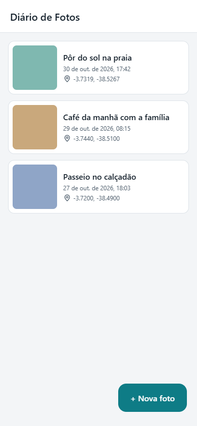
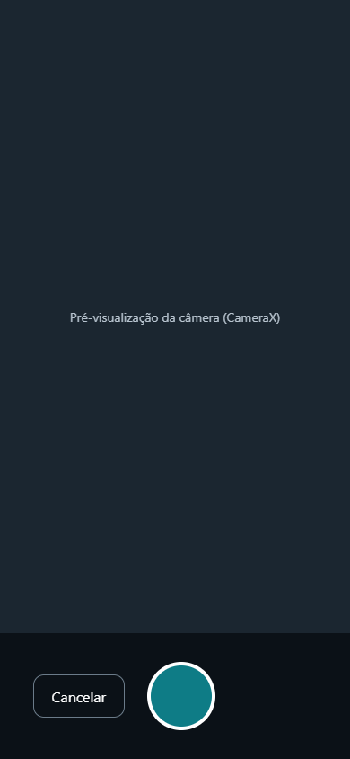
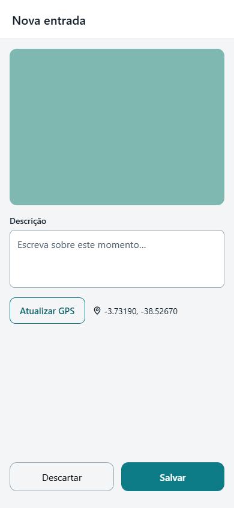
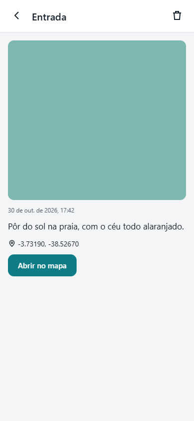

# Diario de Fotos

## Informacoes do aluno

- **Nome:** Marcio Evandro Pereira da Silva
- **Data de entrega:** 30/10/2026

## Tema do projeto

O tema que escolhi foi um diário de fotos. Escolhi esse tema porque já existem muitos aplicativos assim por aí e resolvi fazer o meu.

## Descricao do aplicativo

O Diario de Fotos possui telas para lista, camera, nova entrada e detalhes.

1. Na tela inicial, o usuario visualiza suas entradas em cards.
2. Ao selecionar **Nova foto**, a CameraX abre para capturar uma imagem.
3. Depois da captura, o usuario pode escrever uma descricao e obter sua coordenada GPS.
4. Ao salvar, a foto e seus dados ficam registrados localmente.
5. Na tela de detalhes, a foto pode ser visualizada, a coordenada pode ser aberta em mapas ou a entrada pode ser excluida.

## Tecnologias utilizadas

- Kotlin
- Jetpack Compose e Material 3
- Navigation Compose
- Android ViewModel, StateFlow, `remember` e `mutableStateOf`
- CameraX
- Localizacao GPS com Play Services
- Coil para exibicao das imagens

## Arquitetura

O projeto possui separacao inspirada em MVVM:

```text
UI Compose -> DiaryViewModel -> EntryRepository -> Armazenamento local
```

## Persistencia

Atualmente, os dados das entradas sao armazenados em um arquivo JSON em `filesDir`, enquanto as imagens ficam em uma pasta local separada.

Para atender integralmente ao requisito de persistencia com Room, seria necessario adicionar Entity, DAO, RoomDatabase e utilizar o Room no repositorio.

## Navegacao

```text
Lista -> Camera -> Nova entrada -> Lista
Lista -> Detalhes -> Lista
```

## Permissoes

O aplicativo utiliza:

- Camera
- Localizacao aproximada
- Localizacao precisa

## Prototipo

<table>
  <tr>
    <td align="center"><strong>Tela 1</strong><br></td>
    <td align="center"><strong>Tela 2</strong><br></td>
  </tr>
  <tr>
    <td align="center"><strong>Tela 3</strong><br></td>
    <td align="center"><strong>Tela 4</strong><br></td>
  </tr>
</table>

## Como executar

1. Abra o projeto no Android Studio.
2. Aguarde a sincronizacao do Gradle.
3. Conecte um dispositivo fisico ou execute um emulador.
4. Selecione o modulo `app` e clique em **Run**.

Windows:

```powershell
.\gradlew.bat assembleDebug
```

É recomendado usar um dispositivo fisico para testar a camera e o GPS.

## Observacoes

O projeto foi desenvolvido seguindo o fluxo de cadastro de momentos, com foco em uma interface simples, funcional e organizada.
